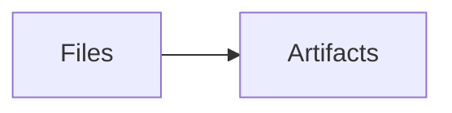

# Weekly report

- shipped **previews**

Inline \(x^2\) and display math:

\[E = mc^2\]

[Metrics](results/data.csv) · <a href="results/report.html">Alignment report</a> · [Notebook](results/analysis.ipynb) · [Notes](results/notes.md)

| Wide table | Value |
| --- | --- |
| WideColumnWideColumnWideColumnWideColumnWideColumnWideColumnWideColumnWideColumnWideColumnWideColumnWideColumnWideColumnWideColumnWideColumnWideColumnWideColumnWideColumnWideColumnWideColumnWideColumn | readable |

